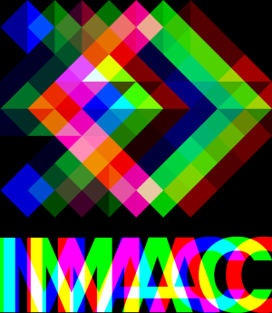
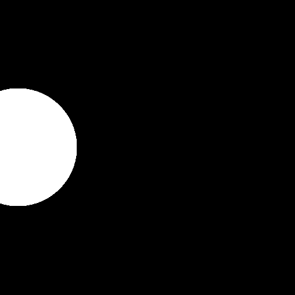
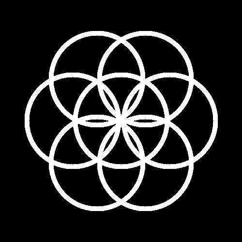
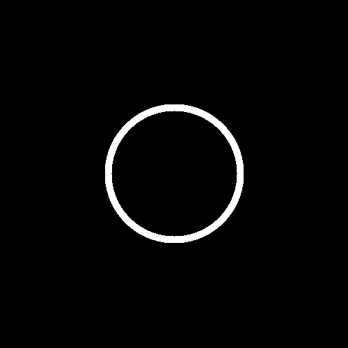
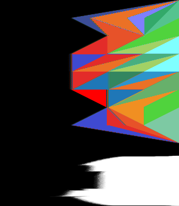
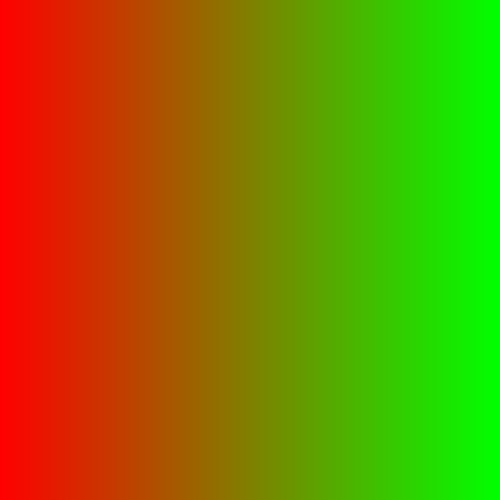
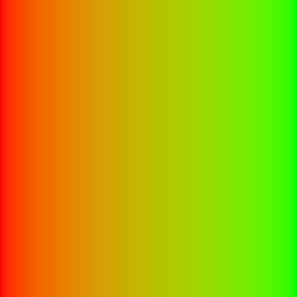

# Rapport Workshop 2026 
#### Nora Gironce - E3 IMAC 
---

## Remarque générale 

**Problème :** au début, mes fonctions modifiaient directement l'image chargée dans le `main`.
Chaque exercice repartait donc de l'image déjà modifiée par l'exercice précédent,
au lieu de repartir de l'image d'origine.

**Solution :** mes fonctions prennent l'image **par copie** et **renvoient** une image :

```cpp
sil::Image negative(sil::Image image)   
{   
    // ...modifications  
    return image;   
} 
```

Je charge l'image une seule fois dans le `main`, et chaque fonction travaille sur sa propre copie.
L'original n'est jamais touché :

```cpp
sil::Image image{"images/logo.png"};     
negative(image).save("output/negative.png");
miror(image).save("output/miror.png");
```

## Exercice 1: Ne garder que le vert

|    Avant      |    Après      | 
| ------------- |  -----------  | 
|| |      
  
## Exercice 2: Échanger les canaux

|    Avant      |    Après      | 
| ------------- |  -----------  | 
|| |      
  
## Exercice 3: Noir & Blanc

|    Avant      |    Après      | 
| ------------- |  -----------  | 
|| |      
  
## Exercice 4: Négatif


|    Avant      |    Après      | 
| ------------- |  -----------  | 
|| |  

## Remarque: 

**Première version :** j'assignais chaque composante séparément.
```cpp
color.r = 1.f - color.r;  
color.g = 1.f - color.g;   
color.b = 1.f - color.b;
```

**Version simplifiée :** j'ai découvert qu'on pouvait assigner les trois composantes en une seule ligne.
```cpp
color = 1.f - color; 
```  
## Exercice 5: Dégradé

  

## Remarque: 

**Première version :** j'assignais chaque composante séparément.
```cpp
image.pixel(x, y).r = gris;  
image.pixel(x, y).g = gris;  
image.pixel(x, y).b = gris;
```

**Version simplifiée :** j'ai découvert qu'on pouvait assigner les trois composantes en une seule ligne.

```cpp
image.pixel(x, y) = glm::vec3{gris, gris, gris};
```

## Exercice 6: Miroir

|    Avant      |    Après      | 
| ------------- |  -----------  | 
|| |      

## Exercice 7: Image bruitée

|    Avant      |    Après      | 
| ------------- |  -----------  | 
|| | 

## Remarque: 

**Erreurs de ma première tentative:**
```cpp
for(glm::vec3& color : image.pixels())  
{   
    color.r = random_int(image.width(), image.height());   
    color.g = random_int(image.width(), image.height());   
    color.b = random_int(image.width(), image.height());  
}
```

**Solution:**

- J'utilisais `random_int(image.width(), image.height())` pour les couleurs : je confondais
  les couleurs avec la taille de l'image, et les nombres obtenus étaient bien trop grands
  (une couleur doit être entre 0 et 1).   
  **Corrigé avec** `random_float(0.f, 1.f)`.

- Je modifiais tous les pixels au lieu de seulement certains.   
  **Corrigé avec la condition** `true_with_probability(0.2f)`.


## Exercice 8: Rotation de 90°

|    Avant      |    Après      | 
| ------------- |  -----------  | 
|| |     

## Exercice 9: RGB split

|    Avant      |    Après      | 
| ------------- |  -----------  | 
|| |     

## Exercice 10: Luminosité

|    Avant      |    Après : assombrissement      | 
| ------------- |  -----------  | 
|| |     

|    Avant      |    Après : éclaircissement    | 
| ------------- |  -----------  | 
|| |    

## Exercice 11: Disque

   

## Exercice 12: Cercle

 

## Exercice 13: Animation



## Remarque 

Mon idée de départ était de créer plusieurs images à la main, en déplaçant à chaque fois la position du cercle. J'ai ensuite pensé à utiliser une boucle pour générer toutes les images automatiquement, sans dupliquer de code.

## Exercice 14: Rosace

  

**Problème :** au début, je ne voyais qu'un seul cercle sur l'image finale.
Chaque cercle était dessiné sur une **copie** de l'image, donc les dessins ne s'accumulaient pas
sur l'image finale.



**Solution :** j'ai créé une fonction qui dessine un cercle et qui prend l'image
**par référence** (avec `&`). Chaque appel dessine alors sur la **même** image :

```cpp
void cercleCentreDifferent(int centre_x, int centre_y, sil::Image& new_image)
```

Ce paramètre me permet aussi de choisir le centre de chaque cercle sans réécrire tout le code.
    

## Exercice 15: Mosaïque

|    Avant      |    Après      | 
| ------------- |  -----------  | 
|| |     

## Exercice 16: Tri de pixels

|    Avant      |    Après : Trier tous les pixels      | 
| ------------- |  -----------  | 
|| |  

|    Avant      |    Après : Trier les lignes     | 
| ------------- |  -----------  | 
|| |  

|    Avant      |    Après : Trier des parties aléatoires      | 
| ------------- |  -----------  | 
|| |  

## Remarque: 

**Erreurs que j'ai faites :**
- J'avais écrit `std::vector<glm::vec3> v{image.pixels()};` **sans `&`**. Je triais donc une
  copie des pixels, et l'image renvoyée restait identique. La correction est
  `std::vector<glm::vec3>& v{image.pixels()};`.
- Ma fonction `brightness` parcourait toute l'image avec une boucle, alors qu'elle doit
  calculer la luminosité d'**un seul pixel** et la renvoyer.
- Dans ma fonction `brightness` avec la moyenne que j'avais au début, chaque couleur compter pour 1/3. Mais, l'œil est plus sensible au vert qu'au rouge, et très peu au bleu. J'ai donc remplacé la moyenne par une **moyenne pondérée** (coefficients de la norme Rec. 709) :

```cpp
float brightness(glm::vec3 color){
    return 0.2126f * color.r + 0.7152f * color.g + 0.0722f * color.b;
}
```
Les coefficients font 1 au total, donc pas besoin de diviser par 3.


## Exercice 17: Dégradés dans l'espace de couleur Lab

|    Avant      |    Après      | 
| ------------- |  -----------  | 
|| | 
 


  

